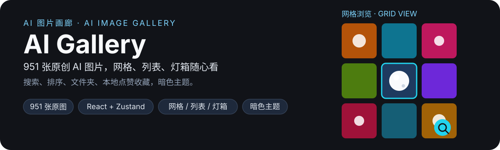
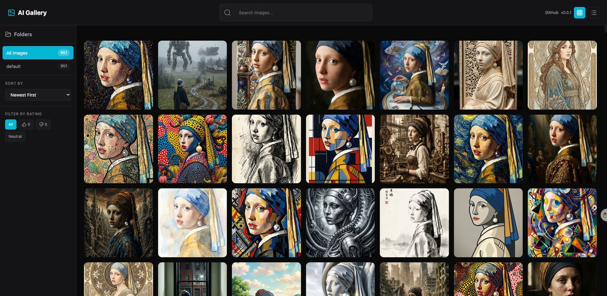

<p align="right"><a href="README.md">中文</a></p>

<p align="center">
  
</p>

<p align="center">
  <a href="https://ai-gallery.xiaosang.cc/">▶ View Online</a>
  ·
  <a href="https://github.com/holynova/ai-gallery">GitHub Repository</a>
</p>

AI Gallery is a static gallery of 951 original AI images, with search, grid/list views, folders, sorting, random browsing, a high-resolution lightbox, and local likes — all in a dark theme. Thumbnails are generated for list previews only; originals stay untouched.

## Screenshots

<p align="center">
  
</p>

<p align="center">
  
</p>

## Features

- **Grid / list views**: switch between two browsing modes with one click; images lazy-load.
- **Search & folders**: search by filename, browse by folder (all 951 images are currently in the `default` folder).
- **7 sort orders**: name, date, and size in ascending and descending order, plus random browsing.
- **High-resolution lightbox**: click to see the original, with keyboard and swipe navigation.
- **Local likes**: likes and dislikes are stored in browser localStorage and can be used as a rating filter.
- **Local upload preview**: drag your own images onto the page to browse them temporarily — nothing leaves your device.
- **Dark theme**: dark throughout, toggleable.

## Adding Images

Drop originals into `public/images/` and run the prepare script once; it regenerates the image catalog (`config.json`) and any missing thumbnails, without re-cataloging thumbnails or rewriting originals:

```bash
pnpm run prepare:static
```

## Run Locally

```bash
pnpm install --frozen-lockfile
pnpm run dev
```

Verify gallery integrity (catalog matches files):

```bash
pnpm run check:gallery
```

## Tech

- React 19 + TypeScript + Vite, Zustand for state, Tailwind CSS 4 for styling.
- Lightbox: yet-another-react-lightbox; thumbnails: sharp.
- No backend: the image catalog is a static `config.json` generated at build time, so the whole site can be statically hosted.
- The full original library is about 2.1 GB, over GitHub Pages' 1 GB site limit, so the Pages site keeps only a historical version.

```
public/images/      951 originals + auto-generated thumbnails + config.json catalog
src/App.tsx         Main UI: search, folders, sorting, rating filter
src/components/     GalleryGrid / ImageCard / Lightbox / Toolbar / UploadZone
src/hooks/          useGallery / useLightbox / useImageRatings / useDarkMode / useLazyLoad
src/store/          Zustand gallery state
scripts/            generate-config.js / generate-thumbnails.mjs / check-gallery.mjs
```
