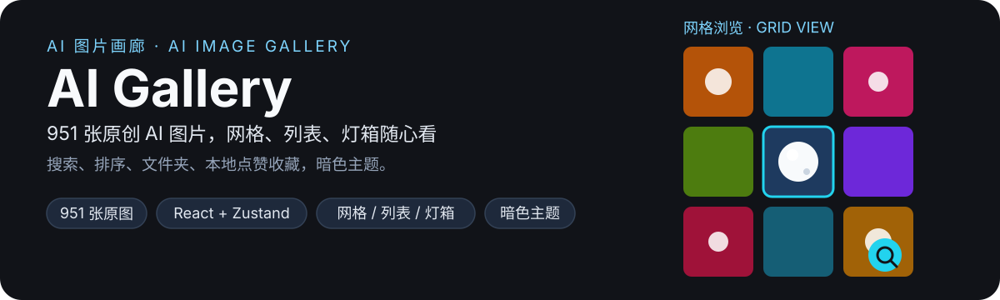
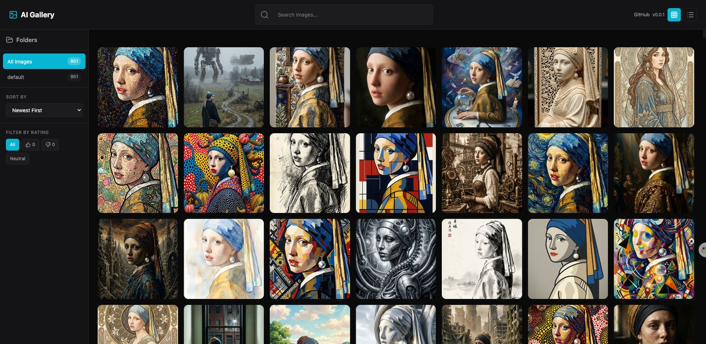

<p align="right"><a href="README.en.md">English</a></p>

<p align="center">
  
</p>

<p align="center">
  <a href="https://ai-gallery.xiaosang.cc/">▶ 在线浏览</a>
  ·
  <a href="https://github.com/holynova/ai-gallery">GitHub 仓库</a>
</p>

AI Gallery 是一个静态 AI 图片画廊：收录 951 张原创 AI 图片，支持搜索、网格 / 列表切换、文件夹、排序、随机浏览与高清灯箱，点赞收藏存在本地，暗色主题。缩略图只用于列表预览，原图保持不变。

## 截图

<p align="center">
  
</p>

<p align="center">
  
</p>

## 功能

- **网格 / 列表视图**：一键切换两种浏览方式，图片懒加载。
- **搜索与文件夹**：按文件名搜索，按文件夹分组浏览（当前 951 张都在 default 分组）。
- **7 种排序**：名称、日期、大小各升降序，外加随机浏览。
- **高清灯箱**：点击看原图，支持键盘与手势切换。
- **本地点赞收藏**：点赞 / 点踩存在浏览器 localStorage，可按评分筛选。
- **本地上传预览**：拖放自己的图片到页面即可临时浏览，不上传服务器。
- **暗色主题**：全站暗色，可切换。

## 添加图片

原图放入 `public/images/`，运行一次准备脚本，自动生成图片清单（`config.json`）与缺少的缩略图，不会把缩略图重复收录，也不会改写原图：

```bash
pnpm run prepare:static
```

## 本地运行

```bash
pnpm install --frozen-lockfile
pnpm run dev
```

检查画廊完整性（清单与文件是否一致）：

```bash
pnpm run check:gallery
```

## 技术

- React 19 + TypeScript + Vite，状态用 Zustand，样式用 Tailwind CSS 4。
- 灯箱用 yet-another-react-lightbox；缩略图生成用 sharp。
- 零后端：图片清单是构建时生成的静态 `config.json`，整站可静态托管。
- 完整原图库约 2.1 GB，超过 GitHub Pages 的 1 GB 站点限制，Pages 站点仅保留历史版本。

```
public/images/      951 张原图 + 自动生成的缩略图 + config.json 图片清单
src/App.tsx         主界面：搜索、文件夹、排序、评分筛选
src/components/     GalleryGrid / ImageCard / Lightbox / Toolbar / UploadZone
src/hooks/          useGallery / useLightbox / useImageRatings / useDarkMode / useLazyLoad
src/store/          Zustand 画廊状态
scripts/            generate-config.js / generate-thumbnails.mjs / check-gallery.mjs
```
