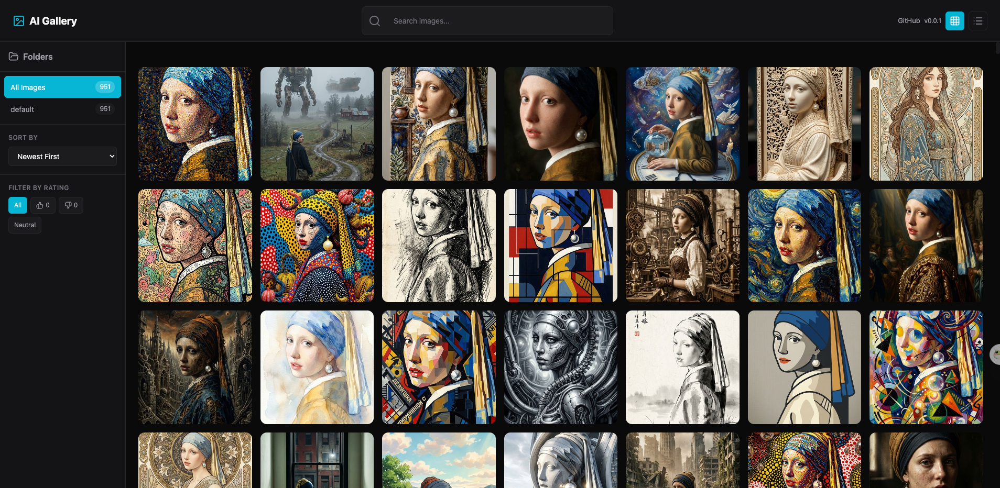

# AI Gallery / AI 图片画廊

A static gallery built with React + Zustand, with 951 original AI images in version 0.0.1.

使用 React + Zustand 构建的静态 AI 图片画廊，v0.0.1 收录 951 张原图，支持搜索、网格/列表切换、随机浏览、高清灯箱与本地点赞收藏。缩略图仅用于列表预览，原图保持不变。

**Demo:** https://ai-gallery.xiaosang.cc/

**Repo:** https://github.com/holynova/ai-gallery




---

## Features / 功能

- Grid & list view / 网格/列表视图
- Search & folders / 搜索和文件夹
- Lightbox preview / 灯箱预览
- Dark theme / 暗色主题

## How to Add Images / 如何添加图片

1. Put images in `public/images/` folder
2. Run `pnpm run prepare:static` to generate the image catalog and missing thumbnails.

将原图放入 `public/images/`，运行 `pnpm run prepare:static` 自动生成图片清单与缺少的缩略图；不会把缩略图重复收录，也不会改写原图。

## Quick Start

```bash
pnpm install --frozen-lockfile
pnpm run dev
```

## Build and Publish / 构建与发布

```bash
pnpm run lint
pnpm run build
pnpm run check:gallery
pnpm run deploy:check
pnpm run deploy
```

The `main` branch is the single source of truth. Cloudflare Worker `ai-gallery` is deployed manually with the pinned Wrangler version. The existing GitHub Pages workflow uses `pnpm run build:pages` as a fallback; Cloudflare uses the root path.

唯一源码分支为 `main`，使用锁定版本的 Wrangler 手动部署现有 Worker `ai-gallery`。保留既有 GitHub Pages 工作流作回退，不创建新的发布分支或 Cloudflare 自动部署。
